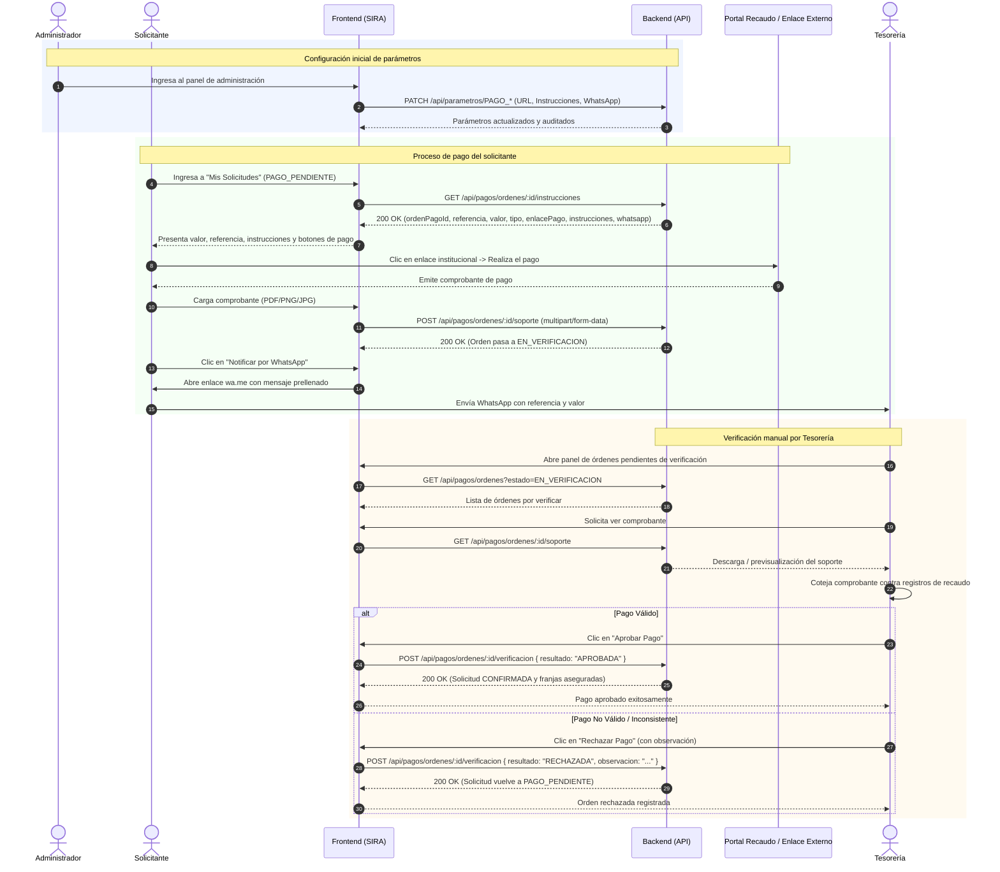

# Pago por Enlace con Verificación Manual

> Documento técnico de arquitectura y operación para el recaudo y confirmación de pagos de solicitudes de espacios en SIRA.

---

## 1. Contexto y Decisión del Proyecto

Por decisión del director del proyecto de grado, **SIRA no integra una pasarela de pago real activa** para evitar añadir la complejidad administrativa, comercial y legal que ello implica (requiere suscripción de contrato comercial con el proveedor de pagos, RUT y cuenta bancaria de la institución). En su lugar, el director autorizó una solución alterna que permite operar el recaudo de forma desacoplada y sin pasarela directa.

### Razones y consideraciones técnicas:
1. **Evitar complejidad administrativa y comercial:** La integración activa de una pasarela en producción requiere un contrato comercial formal, RUT y cuenta bancaria institucional ante la entidad recaudadora, requisitos que no forman parte del alcance del proyecto de grado.
2. **Solución alterna requerida:** Se diseñó e implementó la modalidad de **"Pago por enlace con verificación manual"**: el sistema genera la orden con su referencia única (`OP-YYYY-NNNNNN`), presenta un enlace externo configurable hacia el portal de recaudo institucional, permite adjuntar el soporte de pago para congelar el vencimiento y facilita alertar a Tesorería a través de WhatsApp mediante un mensaje estructurado.
3. **Desacoplamiento técnico verificado:** Los adaptadores y el código de pasarelas de pago (`wompi`, `epayco`, `bold`, `ecollect` y `simulador`) se conservan implementados en el backend bajo un puerto hexagonal desacoplado, pero permanecen apagados configurando la variable de entorno:
   ```env
   PASARELA_PROVEEDOR=ninguna
   ```

---

## 2. Flujo Paso a Paso

El proceso involucra tres actores principales: el **Administrador**, el **Solicitante** y el área de **Tesorería**.

### 2.1. Fase de Configuración (Administrador)
1. El Administrador define los parámetros de contacto e instrucciones en la tabla `parametro` (mediante el panel de gestión o el endpoint `PATCH /api/parametros/:clave`):
   - `PAGO_ENLACE_URL`: Enlace al portal de recaudo o pasarela externa institucional.
   - `PAGO_INSTRUCCIONES`: Guía detallada con instrucciones de pago y referencia a incluir.
   - `PAGO_WHATSAPP_AREA`: Número telefónico oficial de Tesorería para atención y recepción de alertas.
   - `PAGO_CORREO_AREA`: Buzón de correo electrónico de Tesorería.

### 2.2. Fase de Pago y Notificación (Solicitante)
1. Una vez aprobada la cotización de su solicitud de reserva externa, la solicitud pasa a estado `PAGO_PENDIENTE`.
2. Se genera o recupera la orden de pago correspondiente (`POST /api/pagos/ordenes` o `POST /api/pagos/ordenes/:id/saldo`).
3. El frontend consulta las directrices de pago mediante:
   ```http
   GET /api/pagos/ordenes/:id/instrucciones
   ```
4. La interfaz muestra al solicitante:
   - El monto en pesos colombianos y la fecha/hora de vencimiento.
   - El botón para abrir el enlace externo de pago (`enlacePago`).
   - El bloque de texto con las instrucciones oficiales (`instrucciones`).
   - Un botón de acción directa a WhatsApp con el mensaje prellenado oficial (`whatsapp.url`).
5. El solicitante efectúa el pago en el portal o canal habilitado y obtiene el recibo/comprobante (PDF, JPG o PNG).
6. El solicitante adjunta el soporte mediante:
   ```http
   POST /api/pagos/ordenes/:id/soporte
   ```
   - Al cargar el archivo, la orden pasa a estado `EN_VERIFICACION`.
   - **Regla de negocio:** Una orden `EN_VERIFICACION` congela su temporizador y **no vence** mientras tesorería la evalúa.
7. El solicitante hace clic en el enlace de WhatsApp para abrir la conversación con Tesorería y alertar sobre la carga del comprobante.

### 2.3. Fase de Verificación y Confirmación (Tesorería)
1. El funcionario de Tesorería ingresa al panel de pagos (`GET /api/pagos/ordenes?estado=EN_VERIFICACION`).
2. Descarga y visualiza el comprobante adjunto mediante:
   ```http
   GET /api/pagos/ordenes/:id/soporte
   ```
3. Contrasta el valor y la referencia `OP-` del comprobante contra los registros de recaudo.
4. Emite la verificación mediante:
   ```http
   POST /api/pagos/ordenes/:id/verificacion
   ```
   - **Si aprueba (`APROBADA`):**
     - La orden pasa a `APROBADA`.
     - Si la orden cubría el monto total o el saldo final, la solicitud pasa a `CONFIRMADA` y sus franjas horarias quedan aseguradas definitivamente en el calendario (RN-11).
     - Si la orden era un `ANTICIPO`, la solicitud se confirma y se deja habilitada la orden de `SALDO` pendiente.
   - **Si rechaza (`RECHAZADA`):**
     - Se exige un motivo u observación explicativa.
     - La solicitud retorna a `PAGO_PENDIENTE` para que el solicitante corrija el soporte o genere una nueva orden.

---

## 3. Diagrama de Secuencia



---

## 4. Parámetros de Configuración `PAGO_*`

Los parámetros de pago se almacenan en la tabla `parametro` de la base de datos PostgreSQL y pueden ser editados en caliente por usuarios con rol `ADMINISTRADOR`.

| Clave | Tipo | Descripción | Ejemplo |
|---|---|---|---|
| `PAGO_ENLACE_URL` | `string` | URL HTTPS del portal de recaudo institucional. Si está vacío (`""`), la UI omite el botón de enlace externo. | `https://pagos.ejemplo.edu.co/recaudo` |
| `PAGO_INSTRUCCIONES` | `string` | Texto con las directrices claras para el solicitante (cuenta, pasos para consignar e indicación de incluir la referencia OP). | `Consigne a la cuenta indicada por tesoreria e incluya la referencia OP-...` |
| `PAGO_WHATSAPP_AREA` | `string` | Número telefónico de WhatsApp de Tesorería. Debe contener solo dígitos incluyendo el código de país (entre 10 y 15 dígitos), o cadena vacía (`""`) si no se habilita este canal. | `573001234567` |
| `PAGO_CORREO_AREA` | `string` | Dirección de correo electrónico de Tesorería para contacto secundario o notificaciones. | `tesoreria@ejemplo.edu.co` |

### Cómo consultarlos y actualizarlos

- **Listar parámetros:**
  ```http
  GET /api/parametros
  Authorization: Bearer <token_admin>
  ```
- **Modificar un parámetro:**
  ```http
  PATCH /api/parametros/PAGO_ENLACE_URL
  Authorization: Bearer <token_admin>
  Content-Type: application/json

  {
    "valor": "https://pagos.ejemplo.edu.co/recaudo"
  }
  ```
- Cada modificación se valida tipológicamente y queda registrada en la bitácora de auditoría inmutable de SIRA.

---

## 5. Especificación del Endpoint de Instrucciones

```http
GET /api/pagos/ordenes/:id/instrucciones
```

### Seguridad y Permisos
- Requiere autenticación `Bearer JWT`.
- Autorizado para: el **dueño de la solicitud**, usuarios con rol **`TESORERIA`** o **`ADMINISTRADOR`**.
- Usuarios ajenos reciben `403 Forbidden` o `404 Not Found`.

### Precondiciones y Estados Válidos
- Solo disponible si la orden está en uno de los siguientes estados:
  - `PENDIENTE`: Lista para pagar o subir soporte.
  - `RECHAZADA`: Tesorería rechazó el soporte anterior; se permiten ver instrucciones para corregir o reintentar.
  - `EN_VERIFICACION`: El soporte ya fue cargado y se encuentra en revisión.
- Si la solicitud es **exenta** de pago (RN-08) o la orden se encuentra en un estado terminal distinto (`APROBADA`, `VENCIDA`, `ANULADA`), la API responde:
  ```http
  HTTP/1.1 409 Conflict
  Content-Type: application/json

  {
    "codigo": "ORDEN_NO_PERMITIDA",
    "mensaje": "La orden no admite consulta de instrucciones en su estado actual."
  }
  ```

### Estructura de Respuesta (200 OK)
```json
{
  "ordenPagoId": "a1b2c3d4-e5f6-7890-abcd-ef1234567890",
  "referencia": "OP-2026-000042",
  "valor": 450000,
  "tipo": "TOTAL",
  "estado": "PENDIENTE",
  "venceEn": "2026-11-25T18:00:00.000Z",
  "enlacePago": "https://pagos.ejemplo.edu.co/recaudo",
  "instrucciones": "Consigne a la cuenta indicada por tesoreria e incluya la referencia OP-2026-000042.",
  "pasarelaEnLinea": false,
  "whatsapp": {
    "numero": "573001234567",
    "url": "https://wa.me/573001234567?text=Hola%2C%20soy%20Solicitante%20Ejemplo.%20Realic%C3%A9%20el%20pago%20de%20la%20orden%20OP-2026-000042%20por%20%24%20450.000%20de%20la%20solicitud%20SOL-2026-0012.%20Ya%20cargu%C3%A9%20el%20comprobante%20en%20SIRA."
  }
}
```

### Reglas de Construcción del Enlace de WhatsApp
- Si `PAGO_WHATSAPP_AREA` está configurado con un número válido, el backend genera el objeto `whatsapp`. Si está vacío, retorna `null`.
- **Estructura de la URL:**
  ```text
  https://wa.me/<PAGO_WHATSAPP_AREA>?text=<encodeURIComponent(mensaje)>
  ```
- **Plantilla exacta del mensaje:**
  ```text
  Hola, soy <nombre solicitante>. Realicé el pago de la orden <referencia> por <valor formato $ 1.234.567> de la solicitud <consecutivo>. Ya cargué el comprobante en SIRA.
  ```
- **Propiedad `pasarelaEnLinea`:**
  - `false` cuando `PASARELA_PROVEEDOR === 'ninguna'` (modo estándar oficial).
  - `true` únicamente si se ha activado un proveedor de pasarela (`wompi`, `epayco`, `bold`, `ecollect` o `simulador`).

---

## 6. Modalidades de Cobro: Anticipo y Saldo

SIRA implementa el ciclo de cobro mediante el discriminador `tipo` en la orden de pago:

| Tipo | Descripción | Cuándo se emite |
|---|---|---|
| `TOTAL` | Cobro del 100 % del valor cotizado más el depósito de garantía en una única orden. | Modo predeterminado cuando el parámetro `PORCENTAJE_ANTICIPO = 0`. |
| `ANTICIPO` | Cobro del porcentaje inicial definido (ej. 30 % o 50 %) de la cotización más el depósito. | Cuando `PORCENTAJE_ANTICIPO > 0`. Permite apartar y confirmar la reserva asegurando las franjas horarias. |
| `SALDO` | Cobro del remanente para completar el 100 % del servicio. | Se genera o consulta mediante `POST /api/pagos/ordenes/:id/saldo` una vez aprobado el anticipo. |

### Reglas de negocio para Anticipo y Saldo
1. **Conservación de la reserva confirmada:** Al aprobarse la orden de `ANTICIPO`, la solicitud pasa a estado `CONFIRMADA` y sus franjas horarias quedan aseguradas. El saldo pendiente no invalida la reserva previa, pero debe cubrirse antes de la fecha límite establecida por `DIAS_SALDO_ANTES_EVENTO`.
2. **Cálculo de la diferencia exacta:** El valor del saldo se calcula como `valor_total_cotizacion - valor_anticipo_aprobado`, garantizando que la suma de ambos equivalga al valor total sin diferencias de centavos.
3. **Vencimiento congelado:** Al cargar el soporte del saldo (`POST /api/pagos/ordenes/:saldoId/soporte`), este entra en `EN_VERIFICACION` evitando el vencimiento de la orden mientras tesorería revisa el pago.

---

## 7. Activación Futura de una Pasarela Real

Si en el futuro se decide integrar una pasarela de pagos en línea, el sistema SIRA se encuentra completamente preparado a nivel de arquitectura mediante su puerto hexagonal `PasarelaPort`.

### Selector principal
En el archivo de entorno `.env` del backend se define la pasarela activa:
```env
PASARELA_PROVEEDOR=ninguna
```
Valores permitidos: `ninguna`, `wompi`, `epayco`, `bold`, `ecollect`, `simulador`.

### Variables de configuración por proveedor
*(Extraídas fielmente de `src/shared/config/configuracion.ts` y `.env.example`, representadas con marcadores de posición sin valores con apariencia real)*

#### A. Parámetros de Temporización Comunes
- `PASARELA_CONSULTA_MINUTOS`: Tiempo en minutos para la tarea programada de sondeo y consulta activa de transacciones pendientes (entero entre 1 y 1440, por defecto `30`).
- `PASARELA_GRACIA_MINUTOS`: Tiempo en minutos otorgado de gracia al abrir una pasarela para evitar que expire la reserva mientras el usuario paga (entero entre 1 y 1440, por defecto `120`).

#### B. Wompi (`PASARELA_PROVEEDOR=wompi`)
- `WOMPI_AMBIENTE`: Ambiente de ejecución (`test` o `prod`).
- `WOMPI_URL_API`: URL base de la API (`https://sandbox.wompi.co/v1` en test o `https://production.wompi.co/v1` en prod).
- `WOMPI_LLAVE_PUBLICA`: `<llave-publica-comercio>`
- `WOMPI_LLAVE_PRIVADA`: `<llave-privada-comercio>`
- `WOMPI_SECRETO_EVENTOS`: `<secreto-de-eventos>`
- `WOMPI_SECRETO_INTEGRIDAD`: `<secreto-de-integridad>`

#### C. ePayco (`PASARELA_PROVEEDOR=epayco`)
- `EPAYCO_AMBIENTE`: Ambiente de ejecución (`test` o `prod`).
- `EPAYCO_P_CUST_ID_CLIENTE`: `<cliente-id-epayco>`
- `EPAYCO_P_KEY`: `<p-key-epayco>`
- `EPAYCO_LLAVE_PUBLICA`: `<llave-publica-epayco>`
- `EPAYCO_LLAVE_PRIVADA`: `<llave-privada-epayco>`
- `EPAYCO_URL_CONFIRMACION`: `<url-publica-backend>/api/pagos/webhooks/epayco`

#### D. Bold (`PASARELA_PROVEEDOR=bold`)
- `BOLD_AMBIENTE`: Ambiente de ejecución (`test` o `prod`).
- `BOLD_LLAVE_IDENTIDAD`: `<llave-identidad-bold>`
- `BOLD_LLAVE_SECRETA`: `<llave-secreta-bold>`

#### E. eCollect (`PASARELA_PROVEEDOR=ecollect`)
- `ECOLLECT_AMBIENTE`: Ambiente de ejecución (`test` o `prod`).
- `ECOLLECT_ENTITY_CODE`: `<codigo-entidad-ecollect>`
- `ECOLLECT_SRV_CODE`: `<codigo-servicio-ecollect>`
- `ECOLLECT_API_KEY`: `<api-key-ecollect>`
- `ECOLLECT_URL_API`: `<url-api-ecollect>`

---

## 8. Modo Simulador para Pruebas Locales

Para pruebas de desarrollo, control de calidad y pruebas de extremo a extremo (E2E) sin depender de plataformas externas, SIRA incluye un adaptador de simulación completamente funcional.

### 8.1. Configuración del Simulador
En el archivo `.env` del backend:
```env
PASARELA_PROVEEDOR=simulador
SIMULADOR_SECRETO=<secreto-de-al-menos-32-caracteres>
SIMULADOR_URL_API=http://127.0.0.1:3001/api
```

### 8.2. Reglas de Seguridad
- **Prohibido en Producción:** La función `validarConfiguracion` en `src/shared/config/configuracion.ts` rechaza el inicio del backend si `PASARELA_PROVEEDOR=simulador` y `NODE_ENV=production`.
- Longitud mínima de `SIMULADOR_SECRETO`: Al menos 32 caracteres.
- `SIMULADOR_URL_API`: Debe ser una URL HTTP/HTTPS local (`localhost`, `127.0.0.1` o `[::1]`).

### 8.3. Funcionamiento del Simulador
1. Al invocar `POST /api/pagos/ordenes/:id/pasarela`, la API retorna una URL hacia la pantalla interactiva local del simulador:
   ```text
   GET /api/pagos/checkout/simulador?token=<token-firmado-hmac>
   ```
2. La interfaz de simulación presenta al desarrollador o tester tres opciones para simular la respuesta del proceso de pago:
   - **Aprobar transacción:** Simula aprobación exitosa.
   - **Rechazar transacción:** Simula fondos insuficientes o rechazo.
   - **Dejar pendiente:** Simula transacción en proceso.
3. Al enviar la acción, el simulador genera internamente un evento firmado con HMAC-SHA256 y lo despacha al webhook oficial del sistema (`POST /api/pagos/webhooks/simulador`), garantizando que la máquina de estados y las reservas se procesen de forma idéntica a una pasarela real.
